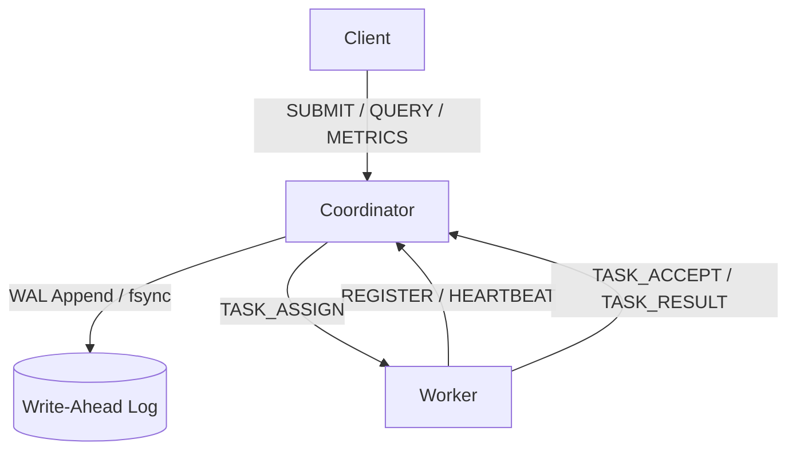

<!--
  ==========================================
  PAVAN KUMAR GP — DEVELOPER PORTFOLIO
  ==========================================
  Clean, modern, dark-themed profile README.
  Built for technical credibility and recruiter readability.
  ==========================================
-->

  

  
  
  

---

### 👨‍💻 About Me

Computer Science and Engineering undergraduate (Class of 2029) focused on **systems programming**, **cloud engineering**, **DevOps**, and **open-source development**. I build practical software systems, explore infrastructure internals, and contribute to real-world projects.

- 🎓 **Education:** B.Tech CSE — Class of 2029
- 💻 **Core Interests:** Systems Programming, Distributed Systems, Cloud Infrastructure, Linux Internals
- 🛠 **Primary Stack:** C, Go, Python, Linux, Docker, AWS, PostgreSQL
- 🚀 **Goals:** Software Engineering Internships, LFX Mentorships, Meaningful Open-Source Contributions
- 🤝 **Philosophy:** Build reliable systems. Understand the layer below. Contribute upstream.

---

### 🛠 Technical Stack

| Category | Technologies |
|----------|--------------|
| **Languages** | `C` `Go` `Python` `JavaScript` `TypeScript` `Shell` |
| **Systems & Infrastructure** | `Linux` `Docker` `Docker Compose` `Kubernetes` `AWS` `nginx` |
| **Databases** | `PostgreSQL` `SQLite` `DynamoDB` |
| **Backend & APIs** | `FastAPI` `REST` `gRPC` `WebSockets` `Amazon Lex V2` `AWS Lambda` |
| **CI/CD & Tooling** | `GitHub Actions` `Git` `Make` `SAM` `Terraform` |
| **Observability & Testing** | `Prometheus` `Grafana` `pytest` `Go test` `ruff` |
| **Domains** | Distributed Systems, Computer Networks, Operating Systems, Write-Ahead Logging, Crash Recovery |

---

### 📊 GitHub Activity

  
  

  

---

### 🚀 Featured Projects

Curated selection of repositories demonstrating systems engineering, cloud infrastructure, and applied research.

#### 1. Intelligent Distributed Runtime (IDR) ⭐ **Strongest Systems Project**
> **A Linux-based distributed task execution runtime written in C** — Coordinator-worker architecture with write-ahead logging, HMAC authentication, crash recovery, and capacity-aware scheduling.

| | |
|---|---|
| **Status** | `v0.2.2` (pre-1.0, actively developed) |
| **Core Tech** | `C` `Linux` `TCP` `fork/exec` `poll` `WAL` `HMAC-SHA256` |
| **Key Features** | Bounded durability (1M tasks, 1ms recovery) • Authenticated networking • Process isolation via `setpgid` • O(q) scheduling • Live metrics dashboard |
| **Repo** | [github.com/pavankumargp6/intelligent-distributed-runtime](https://github.com/pavankumargp6/intelligent-distributed-runtime) |
| **Docs** | [`PROTOCOL.md`](https://github.com/pavankumargp6/intelligent-distributed-runtime/blob/main/docs/PROTOCOL.md) • [`SEMANTICS.md`](https://github.com/pavankumargp6/intelligent-distributed-runtime/blob/main/docs/SEMANTICS.md) • [`BENCHMARK.md`](https://github.com/pavankumargp6/intelligent-distributed-runtime/blob/main/docs/BENCHMARK.md) • [`ROADMAP.md`](https://github.com/pavankumargp6/intelligent-distributed-runtime/blob/main/docs/ROADMAP.md) |
| **Demo** | Built-in observability dashboard (`dashboard/` + `make run`) |

<b>Architecture Overview</b>

**Execution Flow:** Submit → Validate & WAL-record → Schedule → Worker executes via `fork/exec` → Report result → Observe via metrics endpoint.

---

#### 2. PayPal Spend Intelligence Agent
> **Sandbox-first payment monitoring & spend intelligence** — Go backend with PostgreSQL, PayPal Sandbox webhooks, deterministic anomaly detection, and evidence-grounded AI insights.

| | |
|---|---|
| **Status** | Hackathon project (PayPal Sandbox only) |
| **Core Tech** | `Go 1.26` `PostgreSQL` `PayPal Orders v2` `Groq API` `Render` |
| **Key Features** | Signed webhook verification • Deterministic duplicate-capture/fee-mismatch detectors • AI spend insights with citations • Admin-token gated actions • SQL migrations |
| **Repo** | [github.com/pavankumargp6/paypal-ai-auditor](https://github.com/pavankumargp6/paypal-ai-auditor) |
| **Live Demo** | [paypal-ai-auditor.onrender.com](https://paypal-ai-auditor.onrender.com) *(free tier: ~50s cold start)* |
| **Video** | [Demo Walkthrough](https://youtu.be/3Nml_QApt-Y) |

<b>Safety Boundaries</b>

- Detection is **deterministic Go code**; LLM only explains real evidence
- Findings require `ADMIN_TOKEN`; approval records audit — **no money moves**
- Sandbox-only; free-tier hosting (Render) with cold starts
- Fee comparison uses heuristic, not full merchant fee schedule

---

#### 3. PRESS EXIT — Event-Level Football Analytics
> **AQX Sports Analytics Data Bowl 4.0 entry** — Reconstructs post-pressure possession outcomes from StatsBomb 2022 FIFA World Cup data (64 matches, 234K events, 16K pressure rows).

| | |
|---|---|
| **Status** | Competition submission / Research project |
| **Core Tech** | `Python` `StatsBomb` `Streamlit` `pytest` `bootstrap` `pandas` |
| **Key Features** | 10K match-cluster bootstrap CIs • 3×3 sensitivity grid (action window × progression threshold) • Spatial pitch analysis (possessor frame) • 51-test suite • Interactive Streamlit dashboard |
| **Repo** | [github.com/pavankumargp6/press-exit](https://github.com/pavankumargp6/press-exit) |
| **Key Findings** | Counterpress: **2.3× higher turnover rate** (25.9% vs 11.1%) • Progression window-sensitive (17.9%→33.5%) • 36.2% unresolved — explicit tracking avoids survivorship bias |

<b>Methodological Guardrails</b>

- No coordinated pressing claims (individual `Pressure` tags only)
- No causal claims (descriptive associations under differing game states)
- No unsupported player/team rankings (3–7 matches per team)
- Cluster bootstrap respects within-match correlation

---

#### 4. Cloud Portfolio Platform
> **Containerized three-tier application** — FastAPI REST API, PostgreSQL, Nginx reverse proxy, Docker Compose orchestration, GitHub Actions CI with integration tests.

| | |
|---|---|
| **Status** | Complete, tested, CI-validated |
| **Core Tech** | `FastAPI` `PostgreSQL` `nginx` `Docker` `Docker Compose` `GitHub Actions` |
| **Key Features** | Swagger docs • Health checks (app + DB) • Persistent volumes • Automated integration tests • CI pipeline |
| **Repo** | [github.com/pavankumargp6/cloud-portfolio-platform](https://github.com/pavankumargp6/cloud-portfolio-platform) |

---

#### 5. AI Gym Fitness Assistant (UNLOX Fitness)
> **Full-stack fitness application** — Next.js 16 + FastAPI, computer-vision rep counting (MediaPipe), AI diet/chat, WebSocket real-time telemetry, analytics dashboard.

| | |
|---|---|
| **Status** | Active development, modular architecture |
| **Core Tech** | `Next.js 16` `React 19` `TypeScript` `FastAPI` `MediaPipe` `OpenCV` `WebSockets` `Recharts` |
| **Key Features** | Bicep-curl pose detection • AI dietician (OpenAI + fallback) • Virtual gym buddy • Simulated IoT telemetry • 7-day analytics dashboard • JWT auth (backend) |
| **Repo** | [github.com/pavankumargp6/AI-Gym-Fitness-Assistant](https://github.com/pavankumargp6/AI-Gym-Fitness-Assistant) |
| **Limitations** | Single exercise classifier • Simulated IoT • Auth UX incomplete |

---

#### 6. Hotel Booking Chatbot — Amazon Lex V2 + AWS Lambda
> **Serverless conversational booking** — Lex V2 intent with 4 slots, Python Lambda fulfillment, DynamoDB persistence (idempotent, TTL), 122 tests, SAM deployment.

| | |
|---|---|
| **Status** | Implemented & tested locally; not yet deployed to AWS |
| **Core Tech** | `Amazon Lex V2` `AWS Lambda (Python 3.12)` `DynamoDB` `SAM` `pytest` `ruff` |
| **Key Features** | Two-phase slot validation • Decimal money math • Config-driven pricing • Idempotent DynamoDB writes (SHA-256 bookingId) • 122 tests • Minimal AWS SDK surface |
| **Repo** | [github.com/pavankumargp6/hotel-booking-chatbot](https://github.com/pavankumargp6/hotel-booking-chatbot) |
| **Limitations** | Simulated only (no real reservation/payment) • `en_US` only • No availability check |

---

### 🌍 Open Source Contributions

Verified external contributions to established projects. Statuses reflect current state at time of writing.

| Project | PR | Status | Description |
|---------|-----|--------|-------------|
| **Kestra** (Go SDK) | [#477](https://github.com/kestra-io/client-sdk/pull/477) | ✅ **Merged** | Fix `QueryFilter` JSON field serialization — preserve camelCase wire names |
| **Supabase** | [#53678](https://github.com/supabase/supabase/pull/53678) | ✅ **Merged** | Documentation corrections for OAuth and Vector examples |
| **Qiskit** | [#17624](https://github.com/Qiskit/qiskit/pull/17624) | ✅ **Merged** | Scheduling method entry-point contribution |
| **TODO Group / OSPology** | [#864](https://github.com/todogroup/ospology/pull/864) | 📝 **Draft** | Documentation covering CRA and legislative risks |

> **Note:** Pull request statuses can change. Links point to the live PRs for current state.

---

### 📈 Project Highlights at a Glance

| Project | Domain | Primary Language | Stars | Key Signal |
|---------|--------|------------------|-------|------------|
| Intelligent Distributed Runtime | Systems / Distributed | **C** | — | Crash-tested WAL, HMAC auth, 1ms recovery |
| PayPal Spend Intelligence Agent | Cloud / Payments | **Go** | — | Live on Render, deterministic detectors |
| PRESS EXIT | Data Science / Sports | **Python** | — | 10K bootstrap, 64-match corpus |
| Cloud Portfolio Platform | Cloud / DevOps | **Python** | — | Three-tier, CI, health checks |
| AI Gym Fitness Assistant | Full-Stack / CV | **TypeScript/Go** | — | MediaPipe, WebSockets, real-time |
| Hotel Booking Chatbot | Serverless / AWS | **Python** | — | 122 tests, SAM, idempotent DDB |

---

### 📫 Connect

- **GitHub:** [@pavankumargp6](https://github.com/pavankumargp6)
- **Email:** pavankumargp6@gmail.com
- **LinkedIn:** [linkedin.com/in/pavankumargp6](https://linkedin.com/in/pavankumargp6)

---

  <b>Build. Learn. Contribute.</b>

  

